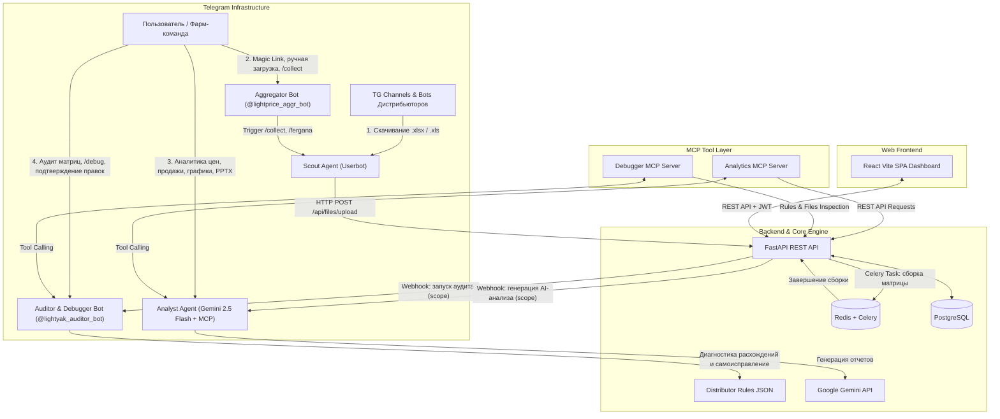

# Price Aggregator Web & Telegram MCP Ecosystem 💊📊

**Price Aggregator MCP Ecosystem** — это независимая многопользовательская веб-панель и интеллектуальная мульти-агентная экосистема из 4 специализированных Telegram-агентов на базе архитектуры **MCP (Model Context Protocol)** и **Google Gemini** для полной автоматизации сбора, сопоставления, аудита и аналитического исследования фармацевтических прайс-листов рынка Узбекистана.

Система круглосуточно осуществляет мониторинг Telegram-каналов и ботов дистрибьюторов, загружает входящие прайс-листы, производит нечёткое сопоставление наименований препаратов (Union-Find + расстояние Левенштейна / RapidFuzz) по каноническому каталогу синонимов, строит визуально оформленные сводные матрицы цен в Excel, проводит автоматический аудит корректности данных с самоисправлением (Self-Healing AI) и предоставляет глубокую бизнес-аналитику (отчёты, интерактивные графики и презентации PowerPoint) через стандартизированный слой **FastMCP** инструментов.

---

## 🌟 Ключевые возможности и архитектура агентов

Экосистема включает в себя 4 четко разграниченных микросервисных компонента, изолированный слой FastMCP-серверов и веб-платформу:



---

### 1. 🕵️‍♂️ Scout Agent (Агент-Сборщик — Pyrogram Userbot)
* **Мониторинг каналов**: Автоматический фоновый сбор свежих прайс-листов из Telegram-каналов и групп ключевых дистрибьюторов (*Meros Pharm, Grand Pharm, Pharm Luxe, Asklepiy, Zenta, Aero Pharm, Drug Promotion, Biotek Farm, Hoji Akbar, Delpharm, Pharma Choice и др.*).
* **Локальный сбор по Ферганской долине**: Изолированный модуль сбора прайсов из 17 каналов и групп местных оптовиков Ферганы, Андижана и Намангана (*Верона, Эверест, Мемори, Гейт, Аззам, Саида, Хожи Акбар, Акмал Фарм, Зилол мед, Фармакосмос, Турон, Макро, Охотник, Гармония, Рефлекс, Саховат, Саидмед Фарм*) по ежедневному расписанию в **14:00 (Asia/Tashkent)**.
* **Опрос ботов-дистрибьюторов по требованию**: Автоматическое взаимодействие с ботами (например, `@vaksinabot`) по заданному расписанию (APScheduler Cron).
* **Интеллектуальная фильтрация**: Распознавание прайсов предоплаты (100%) и отсрочки (25%), фильтрация рекламных брошюр и промо-файлов.
* **Режимы управления через HTTP API (порт 8080)**:
  * `POST /collect` — полный цикл сбора и сборки республиканского сводного прайса.
  * `POST /fetch` — режим «только скачивание» республиканских прайсов без генерации отчета.
  * `POST /collect_fergana` — опрос 17 оптовиков Долины и сборка сводного прайса Ферганской долины.
  * `POST /fetch_fergana` — режим «только скачивание» прайсов 17 оптовиков Долины в изолированную папку `fergana/`.
* **Безопасная передача**: Отправка файлов на бэкенд через изолированный внутренний протокол с проверкой `INTERNAL_API_KEY`. Автоматическое удаление временных локальных файлов в `downloads/` сразу после загрузки во избежание дублирования данных на диске.

---

### 2. 🤖 Aggregator Bot (Технический менеджер — `@lightprice_aggr_bot`)
* **Авторизация Magic Link**: Мгновенный и безопасный вход в веб-панель управления по одноразовой криптографической ссылке (HMAC-SHA256 JWT, TTL 15 минут) без паролей.
* **Ручная загрузка файлов**: Приём `.xlsx` и `.xls` файлов напрямую из личных сообщений и чатов с регистрацией в БД и автоматическим версионированием (`input_history`).
* **Управление конвейером и регионами**:
  * **Республика**: кнопки меню (`📊 Сводный прайс (Республика)`), команды `/collect` (скачать + собрать), `/fetch` (только скачать), `/just_collect` (собрать из уже скачанных файлов).
  * **Ферганская долина**: кнопки меню (`🍇 Сводный (Ферганская долина)`), команды `/collect_fergana` (или `/fergana` — скачать + собрать), `/fetch_fergana` (только скачать в папку `fergana/`), `/just_collect_fergana` (мгновенно собрать матрицу Долины из сохраненных файлов).
  * **Текстовые триггеры**: распознавание сообщений в чате (*«агрегатор»*, *«долина»*, *«фергана»*, *«скачай прайсы»* и др.).
* **Мониторинг состояния**: Мгновенный вывод статуса фоновых сервисов и даты последнего сформированного сводного файла (`/status`).

---

### 3. 🧠 Analyst Agent (ИИ-Аналитик рынка — Google Gemini + FastMCP)
* **Автоматический триггер отчетов (Internal Webhook)**: Встроенный HTTP-сервер (порт `8002`, `POST /trigger_report`). Сразу после завершения сборки сводного прайса на бэкенде бот автоматически формирует аналитический обзор и отправляет его в целевую группу Telegram без необходимости ручного запроса.
* **Региональное разделение (`scope="republic"` / `scope="fergana"`)**:
  * Автоматическое переключение контекста, промптов и графиков в зависимости от региона: общереспубликанский сводный прайс или локальный прайс Ферганской долины (по оптовикам Ферганы, Андижана и Намангана).
  * Распознавание текстовых запросов в чате с ключевыми словами (*«фергана»*, *«долина»*).
* **Новая 3-блочная структура бизнес-отчёта**:
  1. 🏆 **1. Самые дешёвые препараты (Минимальные цены)**: строго один абсолютный лидер по минимальной цене в сумах на каждый ключевой препарат (без избыточных топ-3).
  2. 📈 **2. Изменение цен (Динамика)**: фиксация подорожавших (📈) и подешевевших (📉) позиций по дистрибьюторам с указанием старой и новой цены и точного процента изменения.
  3. 🔄 **3. Отслеживание исчезновения и появления (Наличие)**:
     * ❇️ **Появились / вернулись в прайс** (`appeared_suppliers`): дистрибьюторы и цены вышедших новинок/возвратов.
     * ⚠️ **Пропали из прайса (вымылись)** (`disappeared_suppliers`): позиции, пропавшие по сравнению с прошлым отчетом.
     * 🚨 **Отсутствуют в наличии** (`missing_suppliers` / дефектура): полный список отсутствующих позиций (запрашивается по ключевым словам *«дефицит»*, *«дефектура»*).
* **Фокус на 6 ключевых препаратах компании «Материа Медика»**:
  * Строгая фильтрация анализа по позициям: *Анаферон Детский (таблетки), Анаферон Детский капли, Эргоферон, Ренгалин (таблетки / раствор), Тенотен, Тенотен Детский*.
* **Умная маршрутизация сообщений в закрытых группах**:
  * Автоматическое игнорирование сообщений, адресованных другим ботам (например, `@lightprice_aggr_bot`), и реакция только на прямые упоминания (`@lightprice_analyst_bot`), реплаи или личные диалоги.
* **Автоматический вызов инструментов (Gemini Function Calling & MCP)**: Gemini самостоятельно выбирает и вызывает необходимые инструменты MCP для получения точных фактов перед формированием ответа.
* **Инструменты FastMCP (`mcp_servers/analytics_server.py`)**:
  * `fetch_price_comparison`: сравнение двух сводных прайсов по датам и дефектура.
  * `fetch_manufacturer_trends`: динамика цен брендов за произвольный период (например, *«анализ цен КРКА за 3 дня»*).
  * `fetch_drug_price_history`: детальный срез рынка по конкретному препарату.
  * `fetch_system_summary`: актуальная сводка базы данных, загруженных файлов и сводных отчетов.
  * `fetch_sales_analysis`: анализ помесячной реализации и остатков (XML-парсер `sales_parser.py`).
* **Визуализация (Dark Mode Charts)**: Автоматическая отрисовка графиков динамики минимальных и средних цен в формате PNG (`chart_generator.py`) с поддержкой заголовков для Республики и Ферганской долины.
* **Генерация презентаций PowerPoint (`.pptx`)**: Сборка полноценных 12-слайдовых презентаций с графиками, таблицами и отдельными слайдами по ключевым препаратам.

---

### 4. 🛡️ Auditor & Debugger Agent (Агент-Аудитор — `@lightyak_auditor_bot` + FastMCP)
* **Автономный аудит сводного прайса**: Срабатывает автоматически после каждой генерации сводной матрицы через внутренний вебхук (`POST /audit`).
* **Поддержка аудита Ферганской долины**: Функция `audit_svodny_fergana` производит сквозную сверку позиций сводного прайса Долины с оригинальными прайсами оптовиков в директории `fergana/` при параметре `scope="fergana"`.
* **Глубокое сканирование строк**: Увеличенная глубина анализа неструктурированных сырых прайсов (до 12 000 строк).
* **Инструменты FastMCP (`mcp_servers/debugger_server.py`)**:
  * `get_distributor_rules`: получение актуальной базы правил парсинга.
  * `save_distributor_rule`: обновление правил сопоставления колонок.
  * `audit_excel_file`: инспекция структуры листов, заголовков и строк Excel-файлов дистрибьюторов.
  * `trigger_pipeline_rerun`: запуск фонового пересчета сводного горизонтального отчета.
  * `check_pipeline_task_status`: мониторинг прогресса выполнения задачи в бэкенде.
* **Модуль самоисправления (Self-Healing Engine)**: При обнаружении аномалий ИИ-диагност (`healer.py`) анализирует структуру исходного файла дистрибьютора, находит правильные колонки цен (25% / 100%) и формирует интерактивное предложение по исправлению.
* **Интерактивное управление инцидентами**: Публикация карточки ошибки в чате аудитора с кнопками:
  * *«✅ Применить и пересобрать»* — автоматическое сохранение правила и запуск пересчета матрицы.
  * *«🙈 Игнорировать»* — пропуск ошибки без внесения изменений.
  * *«❌ Отклонить»* — отклонение предложенного исправления.

---

## ⚙️ Ядро сопоставления и обработки (Core Engine)

* **Умный детектор заголовков и скидок**:
  * Автоматический поиск строки с заголовками колонок (Наименование, Цена 100%, Цена 25%, Остаток, Производитель) с поддержкой русских и узбекских названий (*Номи, Махсулот номи, Нархи, Сотув нархи, 100% тўлов, Ишлаб чикарувчи* и др.).
  * Распознавание колонок со скидками (`-4%`, `-3%`, `-2%`, `Цена -4%` и др.) и корректный расчет эффективной цены по дистрибьюторам (включая Grand Pharm, Meros).
* **Дедупликация файлов поставщиков**: При одновременном наличии нескольких версий прайса одного поставщика (например, `.xls` и `.xlsx`) пайплайн автоматически отбирает самый свежий файл по времени изменения (`st_mtime`).
* **Автоматическая очистка исходников (`clear_inputs_after_processing`)**: Удаление временных файлов дистрибьюторов из базы данных и файловой системы сразу после сборки сводного прайса для предотвращения переполнения диска.
* **Строгая нормализация лекарственных форм**:
  * Капли Анаферон имеют безусловный приоритет распознавания и гарантированно не склеиваются с таблетками.
  * Строгое разделение детских и взрослых дозировок (Тенотен детский vs Тенотен).
  * Четкое разделение жидких форм и таблеток (Ренгалин раствор/сироп vs таблетки).
  * Актуализация номенклатуры (исключение устаревших позиций вроде Афалазы).
* **Региональная мульти-агрегация (Республика & Ферганская долина)**: Независимая сборка как общереспубликанского сводного прайса по крупным дистрибьюторам, так и локального сводного отчета по 17 оптовикам Ферганской долины (*Верона, Эверест, Мемори, Гейт, Аззам, Саида, Хожи Акбар, Акмал Фарм, Зилол мед, Фармакосмос, Турон, Макро, Охотник, Гармония, Рефлекс, Саховат, Саидмед Фарм*).
* **Нечеткий матчинг (Fuzzy Matching)**: Алгоритм графической нормализации (Union-Find + RapidFuzz / Левенштейн) объединяет различные варианты написания одного препарата из прайсов разных дистрибьюторов в единую каноническую позицию.
* **Двунаправленная матрица цен**: Формирование как горизонтальной матрицы (препараты в строках, дистрибьюторы в столбцах), так и вертикальной транспонированной матрицы.
* **Стилизация Excel**: Профессиональное оформление отчетов с подсветкой лучших цен, разделением по колонкам 100% и 25% и цветовыми индикаторами.

---

## 📂 Структура проекта

```text
price-aggregator-web-mcp/
├── docker-compose.yml           # Оркестрация микросервисов в Docker
├── .env.example                 # Шаблон переменных окружения
├── README.md                    # Основное руководство пользователя
├── architecture_plan.md         # Архитектурный план экосистемы
├── AI_PROMPTS.md                # Полный реестр системных и пользовательских AI-промптов Gemini
│
├── mcp_servers/                 # Стандартизированные серверы Model Context Protocol (FastMCP)
│   ├── __init__.py
│   ├── analytics_server.py      # MCP Tools аналитики цен, препаратов и продаж
│   └── debugger_server.py       # MCP Tools инспекции Excel-файлов, правил и задач
│
├── backend/                     # Бэкенд на FastAPI и Бот-Агрегатор
│   ├── Dockerfile
│   ├── Шаблон.xlsx              # Базовый Excel-шаблон сводной матрицы
│   ├── requirements.txt         # FastAPI, SQLAlchemy, Celery, openpyxl, rapidfuzz, aiogram
│   └── app/
│       ├── main.py              # Точка входа FastAPI REST API
│       ├── config.py            # Конфигурация бэкенда
│       ├── database.py          # Инициализация подключения к PostgreSQL
│       ├── models/              # Модели БД (User, Settings, CatalogItem, FileRecord, TaskRecord)
│       ├── api/                 # REST API (auth, files, settings, catalog, tasks, analysis)
│       ├── bot/                 # Бот-Агрегатор (@lightprice_aggr_bot)
│       ├── core/                # Вычислительное ядро (Union-Find, матрица, sales parser, excel_reader)
│       └── tasks.py             # Задачи Celery и триггеры аудита/аналитики
│
├── scout_agent/                 # Telegram-парсер каналов дистрибьюторов (Pyrogram)
│   ├── Dockerfile
│   ├── main.py                  # Pyrogram Userbot, APScheduler (14:00 cron) и HTTP-сервер (порт 8080)
│   ├── fergana_channels.py      # Конфигурация 17 каналов и групп оптовиков Ферганской долины
│   ├── fergana_collector.py     # Изолированный модуль сбора и скоринга прайсов Долины
│   └── api_client.py            # Отправка файлов на бэкенд с поддержкой кастомных task_type
│
├── analyst_agent/               # Аналитический бот (aiogram v3 + Gemini AI + FastMCP)
│   ├── Dockerfile
│   ├── main.py                  # Маршрутизация запросов, отправка отчётов и HTTP-сервер (порт 8002)
│   ├── gemini_service.py        # 3-блочные отчеты через Google Gemini с Tool Calling
│   ├── mcp_client.py            # Клиент и схемы MCP Tools для Gemini
│   ├── chart_generator.py       # Построение графиков (Matplotlib Dark Theme PNG)
│   └── presentation_generator.py# Автоматическая сборка презентаций PowerPoint (.pptx)
│
├── debugger_agent/              # Агент-Аудитор и Отладчик (@lightyak_auditor_bot + FastMCP)
│   ├── Dockerfile
│   ├── main.py                  # FastAPI вебхуки и Telegram Polling
│   ├── auditor.py               # Движок аудита республиканского и ферганского прайсов
│   ├── healer.py                # ИИ-диагностика и генерация правил исправления
│   ├── mcp_client.py            # Клиент вызова MCP-инструментов аудитора
│   └── api_client.py            # Сохранение правил и запуск пересборки
│
└── frontend/                    # SPA-интерфейс на React (Vite)
    ├── Dockerfile
    ├── src/                     # React компоненты и страницы
    └── index.css                # Дизайн-система Neon Glassmorphism Dark Mode
```

---

## 🔒 Архитектура безопасности (Security Architecture)

1. **Изоляция межсервисного взаимодействия (Internal API Key Mesh)**:
   * Все внутренние запросы между агентами, MCP-серверами и бэкендом защищены ключом `INTERNAL_API_KEY`.
2. **Безопасная авторизация без паролей (Magic Links)**:
   * Ссылки генерируются с криптографической подписью HMAC-SHA256 и имеют ограниченный срок действия (15 минут).
3. **Ролевое разграничение доступа в Telegram (RBAC)**:
   * Боты проверяют `ALLOWED_TELEGRAM_IDS` и `TELEGRAM_GROUP_ID`.
4. **Сетевая изоляция**:
   * Внутренние микросервисы (база данных PostgreSQL, Redis, отладчик) доступны только внутри виртуальной сети Docker или привязаны к локальному интерфейсу `127.0.0.1`.

---

## 🛠 Технологический стек

* **Бэкенд**: Python 3.10+, **FastAPI** (REST API), **SQLAlchemy 2.0**, **PostgreSQL 15**.
* **Архитектура инструментов**: **FastMCP (Model Context Protocol)**.
* **Очереди задач**: **Redis 7** + **Celery**.
* **Фронтенд**: **React 18** (Vite), **Vanilla CSS** (Neon Glassmorphism Design System).
* **Telegram-Инфраструктура**: **aiogram v3** (Aggregator, Analyst, Auditor Bots), **Pyrogram** (Scout Agent Userbot), **APScheduler**.
* **Искусственный Интеллект**: **Google Gemini API** (Gemini 2.5 Flash с поддержкой Tool Calling).
* **Обработка данных**: **Pandas**, **OpenPyXL**, **RapidFuzz**, **Matplotlib**, **python-pptx**, **NetworkX / Union-Find**.
* **Оркестрация**: **Docker**, **Docker Compose**.

---

## 🚀 Запуск через Docker Compose

```bash
docker compose up --build -d
```

Все сервисы запускаются автоматически в изолированных контейнерах:
- `price_aggregator_mcp_db` (PostgreSQL)
- `price_aggregator_mcp_redis` (Redis)
- `price_aggregator_mcp_backend` (FastAPI, порт `8000`)
- `price_aggregator_mcp_worker` (Celery)
- `price_aggregator_mcp_bot` (Бот-Агрегатор)
- `price_aggregator_mcp_scout` (Userbot Scout)
- `price_aggregator_mcp_analyst` (ИИ-Аналитик с поддержкой FastMCP)
- `price_aggregator_mcp_debugger` (Аудитор & Отладчик, порт `127.0.0.1:8001`)
- `price_aggregator_mcp_frontend` (React Web SPA, порт `5173`)
