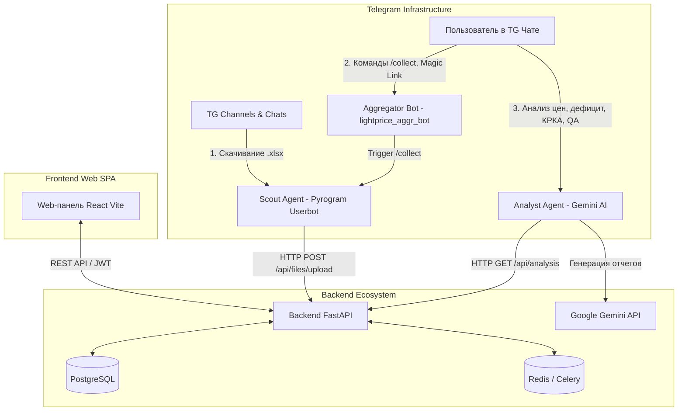

# Price Aggregator Web & Telegram Ecosystem 💊📊

**Price Aggregator Ecosystem** — это независимая многопользовательская веб-панель и мульти-агентная экосистема Telegram-агентов для автоматического сбора, нормализации, объединения и интеллектуального анализа фармацевтических прайс-листов рынка Узбекистана.

Система автоматически отслеживает прайс-листы фармацевтических дистрибьюторов в Telegram-каналах, загружает их на бэкенд, производит нечеткое сопоставление наименований препаратов (Union-Find + расстояние Левенштейна) с учетом каталогов синонимов, строит сводные матрицы цен в Excel и предоставляет аналитические отчеты с использованием искусственного интеллекта (**Google Gemini**).

---

## 🌟 Ключевые возможности

### 1. 🕵️‍♂️ Автоматический сбор прайс-листов (Scout Agent)
* **Мониторинг Telegram-каналов**: Автоматически скачивает свежие `.xlsx` / `.xls` файлы из каналов и чатов дистрибьюторов (*Гранд Фарм, Мерос, Фарм Люкс, Асклепий, Зента, Аэро, Друг Промоушн, Биотек, Хожи Акбар, Delpharm и др.*).
* **Мгновенная передача в Backend API**: Отправляет файлы на сервер по защищенному каналу связи (`INTERNAL_API_KEY`).

### 2. ⚙️ Интеллектуальный парсинг и нечеткое сопоставление (Core Engine)
* **Автоматическое определение структуры таблиц**: Извлечение колонок наименования, цены, производителя и остатка с поддержкой пользовательских пресетов.
* **Многоязычность и транслитерация**: Корректное сопоставление брендов и дистрибьюторов на русском, узбекском языках и латинице.
* **Алгоритм сопоставления синонимов**: Системная база канонических названий и алгоритм графической нормализации (Union-Find + RapidFuzz / Левенштейн) объединяют разрозненные варианты написания в единые позиции.
* **Сборка сводных матриц в Excel**: Формирование визуально оформленных сводных таблиц с ценами всех поставщиков, индикаторами дефицита и динамики цен.

### 3. 🤖 Технический бот-управленец (Aggregator Bot — `@lightprice_aggr_bot`)
* **Авторизация Magic Link**: Автоматическая сгенерированная безопасная одноразовая ссылка для мгновенного входа в веб-панель.
* **Ручная загрузка прайсов**: Прием `.xlsx` файлов напрямую в чат Telegram.
* **Управление сбором**: Запуск принудительного сканирования каналов по команде `/collect` или ключевым словам (*«агрегатор»*, *«сборка»*, *«собери прайсы»*).
* **Проверка состояния**: Запрос текущего статуса работы системы и свежести сводных данных (`/status`).

### 4. 🧠 ИИ-Аналитик рынка (Analyst Agent — Google Gemini)
* **Автоматическая классификация запросов**: Интеллектуальный разбор входящих сообщений пользователя в чате.
* **Общий аналитический отчет**: Сравнение двух последних сводных прайсов (динамика цен, дефицитные позиции, лидеры рынка).
* **Сравнение по произвольным датам**: Анализ изменений цен за указанные пользователем даты (`date1` и `date2`).
* **Анализ по производителю**: Отчет о динамике цен товаров конкретного бренда за последние N дней (например, *«анализ цен КРКА за 3 дня»*).
* **Анализ по препарату**: Детальный срез рынка с ценами и наличием конкретного лекарственного средства (например, *«динамика по препарату Виферон»*).
* **Аналитика продаж и остатков**: Прямой XML-парсинг Excel-файлов отчетов продаж (`sales_parser.py`), расчёт объемов реализации и остатков в разрезе препаратов, месяцев и дистрибьюторов по регионам (например, *«анализ продаж и остатков»*).
* **Построение графиков и диаграмм**: Отрисовка стилизованных дашбордов в стиле Dark Mode (PNG) с динамикой продаж по месяца и долями дистрибьюторов (`chart_generator.py`).
* **Генерация презентаций (.pptx)**: Автоматическая сборка 12-слайдовых презентаций PowerPoint с ключевыми метриками, графиками и отдельными слайдами по целевым препаратам (*Анаферон детский таб/капли, Анаферон взрослый, Эргоферон, Ренгалин таб/раствор, Тенотен детский/взрослый*).
* **Запросы к базе данных и QA**: Получение сводки о состоянии загруженных прайсов, отчетов продаж и объема каталога (например, *«покажи состояние базы»* или *«какие прайсы загружены?»*).
* **Безопасный вывод длинных отчетов**: Разбиение объемных ответов на валидные HTML-фрагменты (`send_report_in_chunks`).
* **Интерактивный UI**: Отображение временного статуса (*«⏳ Запрос принят...»*) с его последующим удалением.

---

## 🏗 Архитектура экосистемы



---

## 📂 Структура проекта

```text
price-aggregator-web/
├── docker-compose.yml           # Оркестрация микросервисов в Docker
├── .env.example                 # Шаблон конфигурации окружения
├── README.md                    # Руководство пользователя и документация
├── architecture_plan.md         # Описание архитектуры и проектных решений
├── Шаблон.xlsx                  # Базовый шаблон сводного отчета
│
├── backend/                     # Бэкенд на FastAPI и Бот-Агрегатор
│   ├── Dockerfile
│   ├── requirements.txt         # FastAPI, SQLAlchemy, Celery, openpyxl, rapidfuzz, etc.
│   ├── test_refactoring.py      # Скрипты интеграционного тестирования ядра
│   └── app/
│       ├── main.py              # Точка входа FastAPI REST API
│       ├── config.py            # Настройки приложения
│       ├── database.py          # Инициализация подключения к PostgreSQL
│       ├── models/              # Модели БД (User, Settings, CatalogItem, FileRecord, TaskRecord)
│       ├── api/                 # REST API Эндпоинты (auth, files, settings, catalog, tasks, analysis)
│       ├── bot/                 # Aggregator Bot (aiogram v3)
│       │   ├── handlers/        # Обработчики команд и сообщений бота
│       │   └── loader.py        # Инициализация бота
│       └── core/                # Ядро обработки прайс-листов
│           ├── price_utils.py   # Базовые утилиты нормализации наименований и цен
│           ├── excel_reader.py  # Автоматический парсинг файлов Excel
│           ├── sales_parser.py  # Прямой XML-парсер Excel-файлов продаж (zipfile)
│           ├── grouping.py      # Алгоритмы нечеткого матчинга и каталог синонимов (Union-Find)
│           ├── matrix_builder.py# Сборка сводных таблиц цен и матрицы присутствия
│           ├── report_formatter.py # Оформление и стилизация XLSX отчетов
│           └── svodny_price.py  # Фасад ядра для обратной совместимости
│
├── scout_agent/                 # Telegram-парсер каналов дистрибьюторов (Pyrogram)
│   ├── Dockerfile
│   ├── main.py                  # Pyrogram Userbot клиент и отслеживание каналов
│   ├── api_client.py            # Загрузка найденных Excel на бэкенд
│   └── config.py                # Переменные окружения Scout-агента
│
├── analyst_agent/               # Аналитический Telegram-бот (aiogram v3 + Gemini AI)
│   ├── Dockerfile
│   ├── main.py                  # Маршрутизация запросов и обработка уведомлений
│   ├── gemini_service.py        # Вызов API Gemini (классификация, генерация отчетов)
│   ├── chart_generator.py       # Отрисовка графиков и диаграмм продаж/цен (Matplotlib PNG)
│   ├── presentation_generator.py# Построение 12-слайдовых презентаций (.pptx)
│   ├── test_visualizers.py      # Модульное тестирование визуализаций
│   ├── backend_client.py        # Клиент взаимодействия с бэкендом (сводки, история)
│   └── config.py                # Конфигурация ключей API и модели ИИ
│
└── frontend/                    # Веб-интерфейс React (Vite)
    ├── Dockerfile
    ├── src/
    │   ├── App.jsx              # Корневой компонент SPA
    │   ├── pages/               # Страницы (Dashboard, Catalog, Settings, Tasks, Auth)
    │   ├── components/          # Модули интерфейса (Header, TabBar, FileUploader)
    │   └── utils/
    │       └── api.js           # Запросы к FastAPI REST API
    └── index.css                # Дизайн-система (Neon Glassmorphism Dark Mode)
```

---

## 🛠 Технологический стек

* **Бэкенд**: Python 3.10+, **FastAPI** (REST API), **SQLAlchemy 2.0**, **PostgreSQL**.
* **Фоновые задачи & Очереди**: **Redis** + **Celery** (фоновый парсинг, нечеткий матчинг и генерация файлов).
* **Фронтенд**: **React 18** (Vite), **Vanilla CSS** (Neon Glassmorphism Design System, адаптивная темная тема).
* **Telegram-Инфраструктура**: **aiogram v3** (Aggregator Bot & Analyst Bot), **Pyrogram** (Scout Agent Userbot).
* **Искусственный Интеллект**: **Google Gemini API** (Gemini 2.5 Flash / настраиваемый `GEMINI_MODEL`).
* **Обработка данных & Визуализация**: **Pandas**, **OpenPyXL**, **RapidFuzz**, **Matplotlib**, **python-pptx**, **NetworkX / Union-Find**.
* **Инфраструктура & Оркестрация**: **Docker**, **Docker Compose**.

---

## 🚀 Быстрый запуск

### 1. Клонирование и настройка окружения
Создайте файл `.env` в корневом каталоге проекта на основе шаблона `.env.example`:

```bash
cp .env.example .env
```

Заполните основные параметры в `.env`:

```env
# Telegram Bots & Security
TELEGRAM_BOT_TOKEN=your_aggregator_bot_token
ALLOWED_TELEGRAM_IDS=123456789,987654321
JWT_SECRET=generate_with_openssl_rand_-hex_32
INTERNAL_API_KEY=generate_with_openssl_rand_-hex_32
TELEGRAM_GROUP_ID=-11111111111

# URLs & Client Hosts
VITE_API_URL=http://localhost:8000
FRONTEND_URL=http://localhost:5173

# Scout Agent (Pyrogram Userbot)
TELEGRAM_API_ID=123456
TELEGRAM_API_HASH=your_telegram_api_hash
TELEGRAM_PHONE=+998901234567
DISTRIBUTOR_CHANNELS=-11111111111,channel_username

# Analyst Agent (Gemini AI)
ANALYST_BOT_TOKEN=your_analyst_bot_token
GEMINI_API_KEY=your_gemini_api_key
GEMINI_MODEL=gemini-2.5-flash
```

> 💡 **Генерация секретных ключей безопасности (`JWT_SECRET` и `INTERNAL_API_KEY`):**
> Для обеспечения защиты данных рекомендуется сгенерировать криптографически стойкие ключи командой:
> ```bash
> openssl rand -hex 32
> ```

### 2. Запуск сервисов через Docker Compose
Запустите сборку и старт всей экосистемы микросервисов в фоновом режиме:

```bash
docker compose up --build -d
```

Команда автоматически запустит:
- `price_aggregator_db`: СУБД PostgreSQL.
- `price_aggregator_redis`: Сервер Redis для очередей задач.
- `price_aggregator_backend`: FastAPI REST API сервер (порт `8000`).
- `price_aggregator_celery`: Воркер фоновых задач Celery.
- `price_aggregator_bot`: Технический управляющий бот aiogram (`@lightprice_aggr_bot`).
- `price_aggregator_scout`: Парсер Telegram-каналов Pyrogram.
- `price_aggregator_analyst`: ИИ-Аналитик рынка (aiogram + Gemini).
- `price_aggregator_frontend`: Веб-панель React (порт `5173`).

---

## 📡 Основные эндпоинты REST API

| Метод | Эндпоинт | Описание |
|---|---|---|
| `POST` | `/api/auth/login` | Авторизация пользователя (JWT-токен) |
| `GET` | `/api/auth/magic-login` | Вход по одноразовому Magic-токену из Telegram-бота |
| `GET` | `/api/files/` | Получение списка загруженных и сгенерированных файлов |
| `POST` | `/api/files/upload` | Загрузка прайс-листа (.xlsx / .xls) |
| `POST` | `/api/files/process` | Запуск фоновой задачи построения сводного прайса (Celery) |
| `GET` | `/api/catalog/` | Просмотр базы канонических наименований и синонимов |
| `POST` | `/api/catalog/add` | Добавление новой позиции или синонима в каталог |
| `GET` | `/api/settings/` | Получение настроек парсинга и пресетов дистрибьюторов |
| `GET` | `/api/analysis/compare` | Сравнение сводных прайсов (с поддержкой дат `date1` и `date2`) |
| `GET` | `/api/analysis/manufacturer` | Аналитика изменения цен по конкретному производителю |
| `GET` | `/api/analysis/drug` | Аналитика изменения цен по выбранному препарату |
| `GET` | `/api/analysis/sales-compare` | Агрегированный анализ реализации и остатков из файлов продаж |
| `GET` | `/api/analysis/system-summary` | Сводная информация о файлах, отчетах продаж и БД для ИИ-агентов |

---

## 💬 Команды и взаимодействие с Telegram-ботами

### 1. Бот-Агрегатор (`@lightprice_aggr_bot`)
* `/start` — Получить персональную одноразовую ссылку (Magic Link) для входа на веб-панель.
* `/collect` — Запустить немедленный сбор свежих прайсов с каналов дистрибьюторов через Scout Agent.
* `/status` — Проверить статус работы фоновых сервисов и дату последнего сводного прайса.
* **Отправка Excel-файла** в чат — Автоматическая загрузка файла в базу бэкенда.

### 2. ИИ-Аналитик (Analyst Bot)
Вы можете отправлять боту свободные текстовые запросы в личные сообщения или упоминать его в рабочей группе:
* *«Анализ рынка за неделю»* или *«Сделай сводный отчет»* — полная аналитика цен и дефицита.
* *«Анализ цен КРКА за 3 дня»* — срез рынка по выбранному производителю.
* *«Динамика цен по препарату Виферон 150»* — детальный анализ наличия и цен препарата.
* *«Сравни прайсы за 20.07.2026 и 25.07.2026»* — сравнение отчетов по указанным датам.
* *«Анализ продаж и остатков»* / *«Динамика реализации по дистрибьюторам»* — аналитика объемов продаж и остатков из Excel-отчетов.
* *«Нарисуй график продаж»* / *«Покажи диаграмму цен»* — визуальный дашборд в формате PNG.
* *«Сделай презентацию»* / *«Подготовь слайды по препаратам»* — многослайдовый отчёт в формате PowerPoint (`.pptx`).
* *«Покажи состояние базы данных»* / *«Какие файлы загружены?»* — сводка о текущем состоянии базы данных (включая отчёты по продажам).

---

## 🧪 Тестирование и верификация

Для запуска автоматических интеграционных тестов ядра обработки прайс-листов и проверки правильности группировки выполните команду в контейнере бэкенда:

```bash
docker exec price_aggregator_backend python /app/test_refactoring.py
```

Тест автоматически проверяет:
1. Корректность распознавания структуры таблиц Excel.
2. Нечеткую группировку наименований и сопоставление по каталогу.
3. Точность расчета цен и дефицита по препаратам (*например, «Анаферон капли»*).
4. Выгрузку агрегированных данных по производителям (*например, «KRKA»*).

